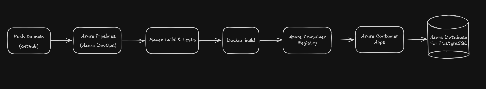
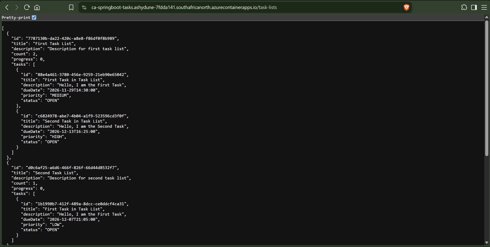
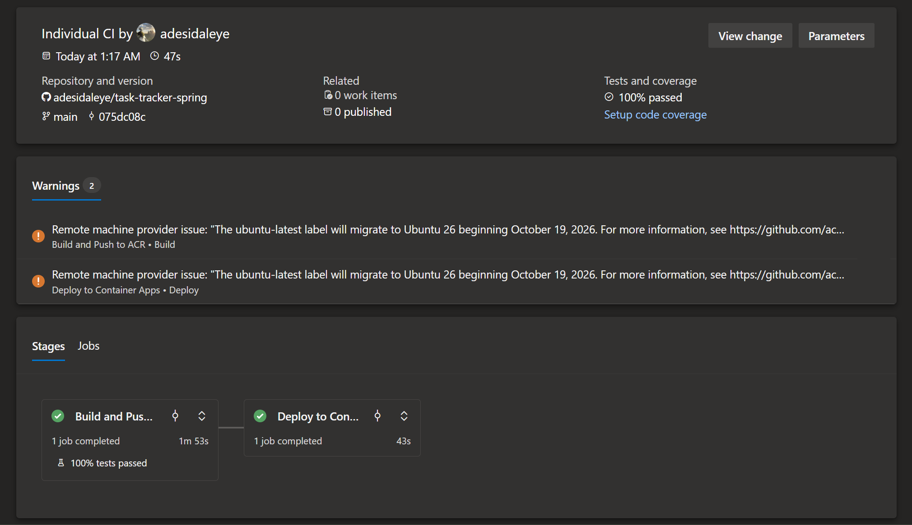

## Azure CI/CD Pipeline for a Spring Boot Task Tracker API

A Spring Boot REST API for managing task lists and tasks, deployed to **Azure Container Apps** through a fully automated **Azure DevOps CI/CD pipeline**. Every push to `main` is built, tested, containerized, pushed to Azure Container Registry, and released with no manual steps.

**Live API:** [Live Azure Container API](https://ca-springboot-tasks.ashydune-7fdda141.southafricanorth.azurecontainerapps.io/task-lists)

---

## Deployment Flow



---

## Tech Stack

| Area | Technology |
|------|------------|
| Language / Framework | Java 21, Spring Boot |
| Build tool | Maven |
| Database | PostgreSQL (locally), Azure Database for PostgreSQL |
| Containerization | Docker|
| CI/CD | Azure DevOps, Azure Pipelines (.yml) |
| Registry | Azure Container Registry (ACR) |
| Hosting | Azure Container Apps |

---

## API Endpoints

### Task Lists

| Method | Endpoint | Description |
|--------|----------|-------------|
| `GET` | `/task-list` | List all task lists |
| `POST` | `/task-list` | Create a task list |
| `GET` | `/task-list/{task_list_id}` | Get a task list by ID |
| `PUT` | `/task-list/{task_list_id}` | Update a task list |
| `DELETE` | `/task-list/{task_list_id}` | Delete a task list |

### Tasks

| Method | Endpoint | Description |
|--------|----------|-------------|
| `GET` | `/task-list/{task_list_id}/tasks` | List tasks in a task list |
| `POST` | `/task-list/{task_list_id}/tasks` | Create a task |
| `GET` | `/task-list/{task_list_id}/tasks/{task_id}` | Get a task by ID |
| `PUT` | `/task-list/{task_list_id}/tasks/{task_id}` | Update a task |
| `DELETE` | `/task-list/{task_list_id}/tasks/{task_id}` | Delete a task |

### API Response

---

## How the Pipeline Works

The pipeline is defined in [`azure-pipelines.yml`](azure-pipelines.yml) and has two stages.

**Stage 1: Build and Push to ACR**
- Runs `mvn clean package` on JDK 21 and publishes JUnit test results.
- Builds the image from the [`Dockerfile`](Dockerfile) and pushes it to ACR using an Azure DevOps service connection.
- Tags every image with the build ID (`$(Build.BuildId)`) for traceability, plus `latest`.

**Stage 2: Deploy to Container Apps**
- Runs only after Stage 1 succeeds.
- Uses the `AzureCLI@2` task to run `az containerapp update` with the new image tag.

## Build & Deployment Results



---

## Running Locally

**Prerequisites:** Java 21, Docker

```bash
# Clone the repo
git clone https://github.com/adesidaleye/task-tracker-spring.git
cd task-tracker-spring

# Start with Docker Compose
docker compose up --build
```

The API will be available at `http://localhost:8080`.

Without Docker, you can also run the app directly (a PostgreSQL instance must be reachable and configured):

```bash
./mvnw spring-boot:run
```

---

## Project Structure

```
task-tracker-spring/
├── src/                    # Spring Boot application source and tests
├── Dockerfile              # Multi-stage image build
├── docker-compose.yml      # Local development setup
├── azure-pipelines.yml     # CI/CD pipeline definition
├── pom.xml                 # Maven configuration
└── mvnw / mvnw.cmd         # Maven wrapper
```

---

## Possible Improvements

- Add more unit and integration tests for the task and task-list endpoints
- Add Swagger/OpenAPI docs for interactive endpoint exploration
- Add a separate staging environment with an approval gate before production
- Move secrets into Azure Key Vault and reference them from Container Apps